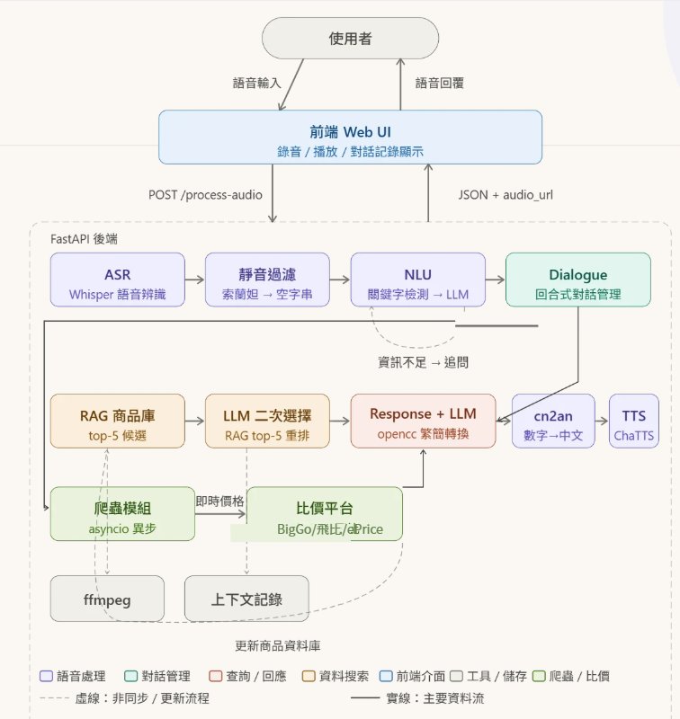

# 🛒 語音比價智慧助手 - 後端非同步多平台網頁爬蟲引擎 (Voice AI Price Assistant)

本專案為大專院校課堂團隊合作開發之「語音比價智慧助手（人機互動專案）」。本系統成功建構了從 **ASR（語音辨識）→ NLU（自然語言理解）→ RAG 商品檢索 → 爬蟲即時比價 → TTS（語音合成）** 的全流水線智慧互動系統。

在團隊中，我獨立負責 **後端資料擷取引擎（Web Scraping Engine）** 的架構與開發，為前端語音助手提供即時、精準的跨平台價格數據。

---

## 📊 系統核心架構與個人定位



如上圖所示，當使用者透過 Web UI 進行語音輸入、經由 LLM 解析購物槽位後，後端會觸發我所開發的**「爬蟲模組」**，即時併發抓取台灣主流電商比價平台（BigGo、飛比價格）的結構化商品數據，並即時回報跨平台最低價推薦。

---

## 🛠️ 我負責的核心技術與效能優化亮點

為了確保語音助手能達到「即時對話」的高流暢度要求，我在爬蟲引擎中實作了以下軟體工程技術：

### 1. 效能突破：全面改寫 `asyncio` 非同步併發架構
* **問題痛點：** 早期採用傳統同步抓取（Synchronous），必須等 BigGo 抓完才能抓飛比，跨平台等待時間過長，嚴重破壞語音互動的即時性。
* **技術解法：** 我將爬蟲全面改寫為 `asyncio` 非同步架構，實現多平台**併發抓取（Concurrency）**，大幅縮短了資料獲取的等待時間，成為系統得以流暢運行的核心關鍵。

### 2. 雙平台動態與靜態網頁解析
* **BigGo 爬蟲 (`scrape_biggo.py`):** 分析網頁後發現其將數據隱藏於 `ssrData` 內。我利用字串定位與深度計數器（Depth Counter），精準截取完整的 JSON 字串並進行結構化解析。
* **飛比價格 爬蟲 (`scrape_feebee.py`):** 使用 BeautifulSoup 解析 HTML DOM 結構。針對飛比多變的 Class 命名，採用動態關鍵字過濾（如 `item` 相關容器），精準分離商品名稱與區間價格。

### 3. 穩定性與防禦性編程 (Robustness & Anti-Bot)
* **自動容錯與暴力補救機制：** 在飛比爬蟲中實作了「備用暴力掃描邏輯」。當標準標籤因網站改版或防禦失效時，程式會自動切換為備用路徑，遍歷 `<a>` 標籤以最大化確保資料不中斷。
* **數據清洗與去重 (De-duplication)：** 針對 BigGo 網頁強制進行 `utf-8` 解碼，並手動清洗特殊跳脫符號，解決 JSON 解析潰散的問題。同時利用資料特徵進行重複資料過濾，確保資料純淨度。
* **動態隨機延遲：** 實作 `random.uniform` 的動態睡眠時間，並模擬真實瀏覽器的 Headers（User-Agent, Referer），降低被目標網站判定為 Bot 的風險。

---

## 📈 專案評估成果 (UX Evaluation)
本系統經由嚴謹的量表測試，獲得極佳的實用性驗證，其中後端爬蟲的高效與穩定功不可沒：
* **SUS 系統可用性量表：** 獲得 **92.5 分**（遠高於業界平均 68 分），驗證系統極具易用性。
* **NASA-TLX 工作負荷分析：** 分數僅 **17 分**（屬於 20 以下的極低認知負荷），證明語音比價流程極為直覺、無負擔。

---

## 📁 專案架構 (Repository Structure)

```text
📁 Voice-AI-Price-Assistant/
│
├── 📁 scrapers/               # 後端資料擷取引擎 (個人獨立負責)
│   ├── 📄 scrape_biggo.py     # BigGo 價格爬蟲 (含 JSON 特殊解析與非同步優化)
│   └── 📄 scrape_feebee.py    # 飛比價格爬蟲 (含 Anti-Bot 與備用暴力補救機制)
│
└── 📁 docs/                   # 團隊專案文件與設計圖
    ├── 📄 system_architecture.png # 系統最終架構圖
    ├── 📄 final_report.pdf    # 團隊期末專案報告
    └── 📄 project_presentation.pptx # 專案簡報 (含量表分析數據)